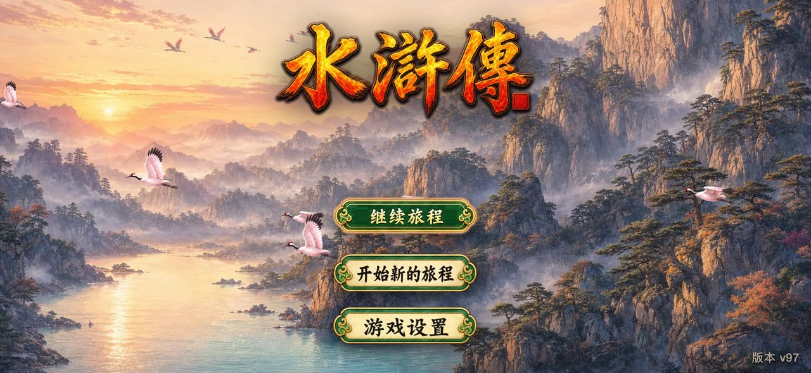
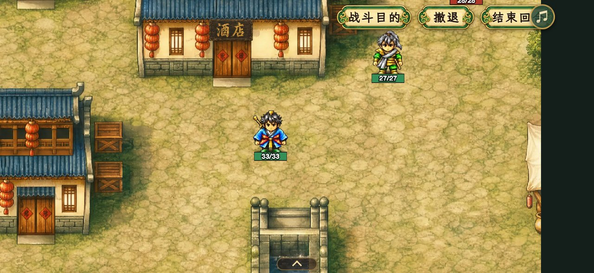
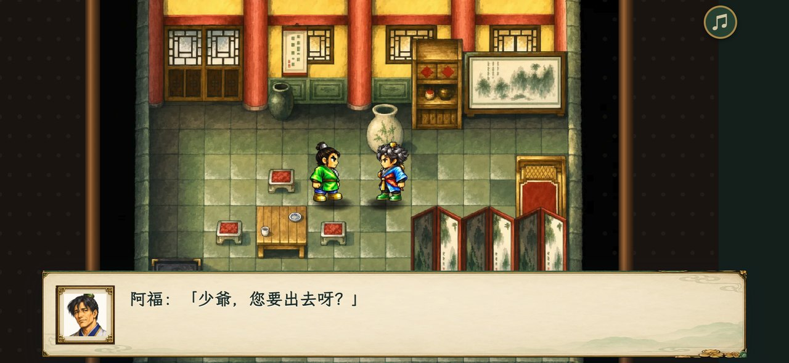
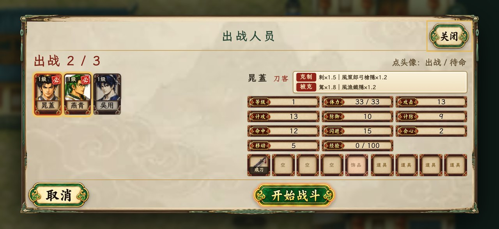
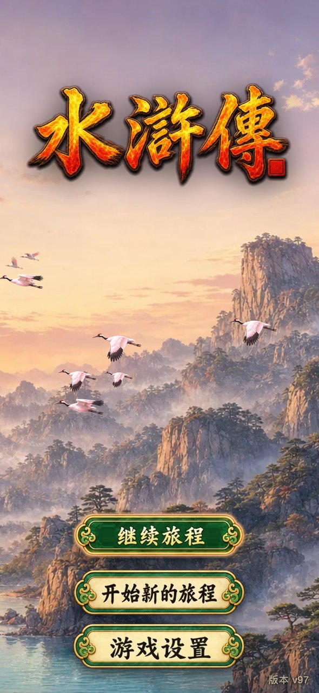
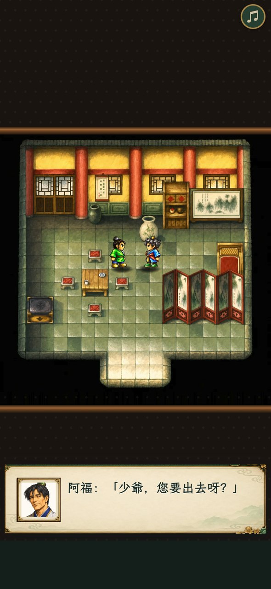
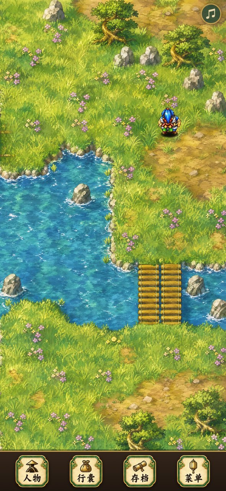
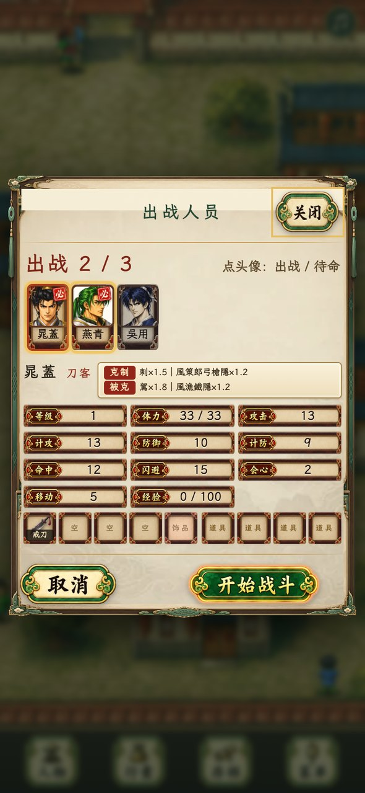
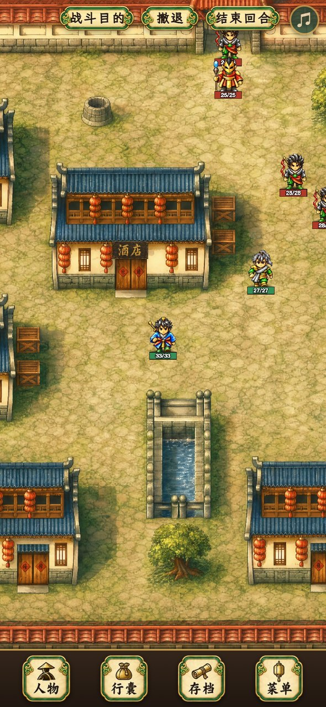

# 水浒传 · HTML5 复刻版

川普科技 1996 年 Mega Drive（世嘉五代）战棋 RPG《水浒传》的完整复刻。游戏不用模拟器跑 ROM，而是先把原版逆向分析清楚，再用 HTML5 把剧情脚本、地图、战斗规则和数值公式一条条重写出来。画面分三种：原版素材、吉卜力手绘、HD-2D 光影，可以随时切换。手机竖屏、横屏、电脑都能玩。

同一份游戏代码打包成五个版本：网页、iPhone、安卓、Windows、Mac。

<p align="center">
  
  
</p>
<p align="center">
  
  
</p>
<p align="center">
  
  
  
  
  
</p>

## 下载

到 [Releases](../../releases/latest) 下载最新版本：

| 平台 | 文件 | 说明 |
|---|---|---|
| iPhone / iPad | `Shuihu-vNN-iOS.ipa` | 开发签名，只能装到已登记的设备上（用 Xcode、Apple Configurator 或 `xcrun devicectl` 安装）。 |
| 安卓 | `Shuihu-vNN-android.apk` | 安卓 7.0 及以上。下载后直接安装，需在系统里允许"安装未知来源应用"。 |
| Windows | `Shuihu-vNN-windows.zip` | Windows 10/11，64 位。解压后运行 `水浒传-Windows\Shuihu.exe`。没有代码签名，第一次运行时 SmartScreen 会提示，点"更多信息 → 仍要运行"。 |
| Mac | `Shuihu-vNN-mac.zip` | Apple 芯片和 Intel 通用。解压后把"水浒传"拖进"应用程序"。没有 Apple 开发者 ID 签名，第一次打开要按住 Control 点图标选"打开"。 |

网页版（测试站，有登录保护）：https://game.areu.pro/shz/game/

标题画面右下角显示版本号（例如"版本 v98"），每次更新都会变，可以用来确认装的是不是最新版。

## 已经完成的工作

### 1. 原版逆向分析（`md-game-analysis/`）

- 以繁体版 ROM 为基准。简体版下载包和它只差 2 个字节，在 Z80 音源驱动里，不影响游戏内容。
- 整理出 ROM 的结构图、反汇编和 Ghidra 分析脚本，并记录每条结论的证据位置，见 [逆向分析报告](md-game-analysis/逆向分析报告.md) 和 [两版本对比](md-game-analysis/两版本对比.md)。
- 文字解码：8 套点阵字库逐字对照，转成 Unicode。对白全部是真实文字，没有烧进图片。
- 数值和公式：职业成长表（1–99 级）、15×15 兵种相克倍率、伤害、命中、闪避、会心公式，随机数发生器，经验和升级规则。
- 用模拟器（Genesis Plus GX）抓原版的运行状态、战斗内存和特效画面，作为复刻时的对照基准。

### 2. 剧情系统

- `dist/js/story.js` 是一个剧情虚拟机，直接解释原版剧情数据区（E2E16–EE2CF）里的脚本字节，不是照着剧情手写的。全部 80 种指令都有对应处理。
- 385 个剧情入口都机械执行过一遍。自动通关工具（`tools/playthrough.mjs`）按玩家的玩法一路推进，打通了全部 36 场战斗，过程中没有脚本错误。
- 实现的内容：剧情标志、NPC 对话计数、地图选择、队伍增员、物品和金钱奖励、12 间商店的原库存和原价（卖价减半，单品最多 99 个）、NPC 隐藏和显示、按章节变化的地图通行修改、脚本行走速度。
- 演出效果：淡入淡出速度（0x28）、白闪（0x47）、人物闪烁（0x3A）、开门停顿（0x14/0x17/0x37/0x46）、地图摆设（0x3D，比如酒车、囚车、倒地的人）、人物头顶表情（0x2E/0x2F/0x30），以及过场人物走出原版 320×224 画面时的淡出。

### 3. 地图与探索

- 116 张地图，28,993 个格子的图块和通行数据和 ROM 逐格一致，有审计报告（[MAP-LOGIC-AUDIT.md](shuihu-html5/MAP-LOGIC-AUDIT.md)）。
- 39 处隐藏物品的位置和领取条件和原版一致，领一次后不会再出现，读档也验证过（[HIDDEN-ITEMS-ANALYSIS.md](shuihu-html5/HIDDEN-ITEMS-ANALYSIS.md)）。
- 前景遮挡：原版素材画风下，人物走到屋檐、树冠后面会被挡住（84 张图有遮挡层）。
- 世界地图选目的地，点地面自动寻路，也可以用虚拟摇杆。
- 未开放的地点在世界地图上不显示，和原版一样。人物和摆设脚下加了较重的地面阴影。

### 4. 战斗系统

- 36 场战斗的出战表、敌我初始位置、必须出战的人物，全部来自 ROM。出战界面一屏放得下 20 个人的头像、属性、装备和道具。
- 战场触发器：每场战斗的增援、指定人物生死、到达目标点、胜负条件，都按原版的阶段调度器（ROM 0x12074）重写，见 `dist/js/stage-rules.js`。
- 敌方和友军 AI 按原版行为模式重写（`dist/js/battle-ai.js`）：守点、追击、治疗、施咒、低血量原地休息、目标评分和站位选择。
- 规则细节：反击、地形能否进入（按兵种和饰品）、穿过己方单位、中毒每回合扣血、混乱、虚弱、破甲、原地待命回血、按职业阶段决定能装备和携带什么、战斗中不能换装备、攻击范围形状。
- 战斗目的说明（ROM 目标表）、撤退（原版的"鳴金收兵"：算战败，回到出战界面，经验保留）、自己的回合可以存档读档、失败可以重试。
- 镜头会跟着行动的一方平滑移动，行动完自动打开下一个人的菜单。经验条、升级、状态剩余回合都会显示。

### 5. 画面与美术

- 三种画风，在"游戏设置"里切换：原版素材 / 吉卜力手绘 / HD-2D 光影。
- 高清地图：116 张地图 × 2 种高清画风，4 倍分辨率，图块位置和原版一一对应，出入口、阻挡、隐藏物品的位置都没有变。
- 高清人物 60 组（每组 9 个动作帧），高清头像 39 张，物品图标 108 个，高清地图摆设 13 张（还在审核中）。
- 战斗特效 10 组（刀剑、飞箭、法术、道具等）。散体符爆炸、受击震动、闪避侧移按原版的表现做。
- 片头动画和标题画面、界面组件（按钮、对话框、面板）都是重新设计的，文字一律是真实文字。
- 美术生产流程：在自己的服务器上批量生图（最多 10 个并发，不自动重试），每张图都和原版对照审核后才放进游戏。素材工坊和生产记录在 `shuihu-assets/`，见 [ART-PRODUCTION.md](shuihu-assets/ART-PRODUCTION.md)。

### 6. 音乐

- 16 首重新制作的配乐（Suno）。地点音乐按原版音乐表（ROM 0x27E16，指令 0x4C）切换。
- 战斗音乐按关卡在 6 首战斗曲里轮换。离开游戏画面时音乐暂停，回来后继续。

### 7. 界面与操作

- 手机竖屏和横屏都专门排过版。横屏时按钮放在右侧，避开灵动岛。手机竖着拿、游戏自己转成横屏也能正常显示。
- 所有对话框、出战、状态、行囊、商店界面，一屏放得下，不用上下滚动（行囊的图标区除外）。
- 对话点任意位置继续。消息只在顶部显示一条小提示，不弹窗。
- 存档：自动存档加 3 个手动存档位，战斗中自己的回合也能存。

### 8. 多平台

| 平台 | 外壳 | 位置 |
|---|---|---|
| 网页 | 静态网站加 Service Worker 离线缓存 | `shuihu-html5/dist/` |
| iOS | SwiftUI + WKWebView，游戏文件打包在 App 里，通过 `app://` 读取 | `ios/Shuihu/` |
| 安卓 | 原生 WebView，不用 Gradle，脚本直接打包签名 | `android/` |
| Windows / Mac | Electron，通过 `app://` 读取 | `desktop/` |

四个 App 都把游戏完整打包在安装包里，打开后不连网，玩法和网页版完全一样。

## 还没完成

- 全部音效（目前只有音乐）。
- 指令 0x36 的全屏旁白，以及特效 0x3B、0x3C、0x44、0x48。
- 开门和表情的专门图形（0x14/0x17/0x37/0x46 目前只有停顿，没有动画）。
- 调色板局部渐变。
- 高清地图摆设还在审核。其中林娘子中箭这一张被生图服务拒绝，暂时用原图放大。

## 目录

```
shuihu-html5/      游戏本体
  dist/            可以直接运行的游戏（网页版就是这个目录）
    js/            游戏代码：app.js 主程序、story.js 剧情虚拟机、battle*.js 战斗、stage-rules.js 战场触发器
    data/          从 ROM 导出的数据：剧情、地图、战斗、商店、对白、音乐表等
    assets/        图片、音乐、字体
  tools/           从 ROM 导出数据的脚本、自动通关、战斗模拟、部署脚本
  tests/           自动化测试（npm test）
shuihu-assets/     素材工坊：原版提取的图集、生图任务和提示词、审核工具
md-game-analysis/  ROM 逆向分析：反汇编、Ghidra 脚本、公式和数值表、运行抓取工具
ios/Shuihu/        iPhone / iPad 外壳
android/           安卓外壳
desktop/           Windows / Mac 外壳
docs/screenshots/  README 截图
```

## 开发

需要 Node.js 22+ 和 Python 3.10+。

本地运行：

```sh
cd shuihu-html5
npm start            # http://localhost:8765
```

测试：

```sh
cd shuihu-html5
npm test
```

打包各平台（版本号取自 `shuihu-html5/dist/sw.js` 里的 `CACHE`，改完游戏先把它加 1）：

```sh
bash shuihu-html5/tools/deploy_workshop_game.sh     # 网页测试站
ios/Shuihu/sync_web.sh                              # iOS：复制游戏文件，再用 Xcode 归档导出
android/build.sh                                    # 安卓：需要 JDK 17 和 Android SDK 35
cd desktop && npm install && npm run build          # Mac 和 Windows
```

各脚本开头的注释写了所需环境。API 密钥、服务器和签名凭据都不在仓库里。
